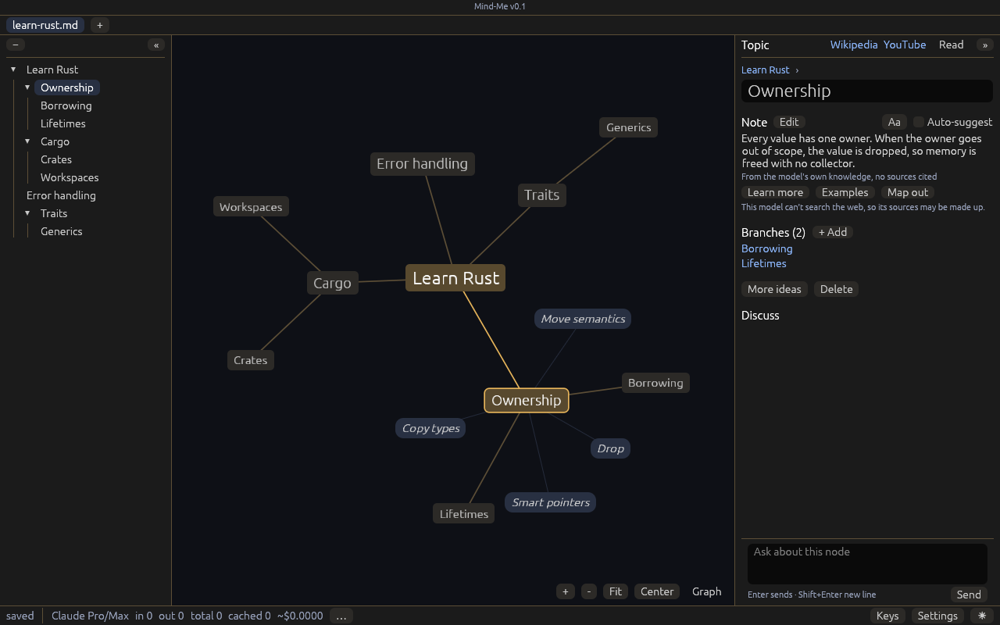

# Mind-Me

[](https://github.com/fullstacksushil/mindme/actions/workflows/release.yml)
[](https://github.com/fullstacksushil/mindme/releases/latest)
[](LICENSE)


A mind map that thinks with you. Type an idea, and the AI suggests branches. Click the ones you want to keep.



## Why use it

- **Start from one idea.** You do not need a plan. Type a word, and the AI offers five branches. Keep the good ones and ignore the rest.
- **You decide what goes in.** Suggestions are faint until you click them. The map holds only what you chose.
- **Learn a new topic fast.** Type a topic and press Ctrl+Enter. The AI draws the whole topic as a map, with a short note and sources on each branch.
- **Go deeper where you want.** On any branch, ask for more detail, examples, or a conversation with the AI.
- **Your maps are yours.** Each map is a plain text file on your computer, in Markdown, a simple text format. Any text editor can open it, and so can Obsidian. Mind-Me has no account and no server.
- **Use the AI you already have.** Claude Pro or Max, ChatGPT through Codex, an API key, or a free model that runs on your own computer.

Try it in your browser first: <https://mindme.cc/try/>

## Install

### Download the app

Ready-made apps are free during the beta. From version 1.0, they cost $20 once, for every 1.x release.

| System | File |
| --- | --- |
| macOS, Apple silicon | [mindme-macos-arm64.dmg](https://github.com/fullstacksushil/mindme/releases/latest/download/mindme-macos-arm64.dmg) |
| Windows, x86_64 | [mindme-windows-x86_64.zip](https://github.com/fullstacksushil/mindme/releases/latest/download/mindme-windows-x86_64.zip) |
| Linux, x86_64 | [mindme-linux-x86_64.AppImage](https://github.com/fullstacksushil/mindme/releases/latest/download/mindme-linux-x86_64.AppImage) or [.tar.gz](https://github.com/fullstacksushil/mindme/releases/latest/download/mindme-linux-x86_64.tar.gz) |

**macOS:** Open the dmg and drag Mind-Me to Applications. The beta is not signed yet. The first time, right-click Mind-Me and choose Open.

**Windows:** Unzip the file and run `Mind-Me.exe`. The beta is not signed yet. If Windows says it protected your PC, click More info, then Run anyway.

**Linux:** Make the file executable, then run it. It needs Ubuntu 22.04, Debian 12, or newer.

```sh
chmod +x mindme-linux-x86_64.AppImage
./mindme-linux-x86_64.AppImage
```

### Build from the source code

Building it yourself is always free. You need [Rust](https://rustup.rs). On Windows, Rust also asks for the Visual Studio C++ build tools. On Linux, install these packages first: `libxkbcommon-dev libwayland-dev libx11-dev libxcursor-dev libxrandr-dev libxi-dev libgl1-mesa-dev`.

```sh
git clone https://github.com/fullstacksushil/mindme
cd mindme
cargo build --release
./target/release/mindme rust.md go.md
```

Each file opens in its own tab. With no file name, Mind-Me opens `map.md`.

## Pick your AI

The first time you open Mind-Me, it asks you to pick an AI:

- **Claude Pro or Max**, if the `claude` command is installed and you are logged in.
- **OpenAI Codex**, if the `codex` command is installed. Run `codex login` first, with ChatGPT or an API key.
- **An API key** from Anthropic, OpenAI, OpenRouter, or another service that works like OpenAI.
- **Ollama**, a free program that runs AI models on your own computer.
- **Any other command** that reads a question and prints an answer.

On Windows, install Claude Code with its native installer. Mind-Me cannot start the npm version, which is a `claude.cmd` file.

Click Test to check that it answers. Click Save to keep it. To add, rename, or remove models later, open Settings, then Models.

## Make it yours

Most choices are in Settings (Ctrl+,):

- **Theme:** Tokyo Night, Catppuccin, Gruvbox, Nord, and more, each in light and dark. The sun or moon button in the footer switches between them.
- **Size and fonts:** Ctrl+= and Ctrl+- change the size. Pick the text font and the code font in Settings.
- **Graph:** Change the text size, line thickness, and how far apart the branches sit.
- **Footer:** Show or hide the token counts and the cost.

### The settings file

For more control, edit `config.json` in your settings folder: `~/.config/mindme/` on macOS and Linux, `%APPDATA%\mindme\` on Windows. This example lists two models and shows the cost of each request:

```json
{
  "models": [
    { "name": "Claude", "cmd": "claude -p --output-format json" },
    { "name": "GPT", "url": "https://api.openai.com/v1/chat/completions", "model": "gpt-5",
      "key_env": "OPENAI_API_KEY", "price": { "in": 1.25, "out": 10, "cached": 0.125 } }
  ],
  "ghosts": "GPT",
  "skills": [{ "name": "Plain English", "file": "~/notes/plain-english.md" }],
  "footer": ["model", "in", "out", "total", "cached", "cost"]
}
```

| Setting | What it does |
| --- | --- |
| `models` | The AIs you can pick for each tab. Give each one a `cmd` (a command) or a `url` and `model` (a web service). |
| `price` | Dollars per million tokens. The footer uses it to show the cost. |
| `ghosts` | Sends the branch suggestions to a cheaper model. Notes, Discuss, and full maps still use the tab's model. |
| `skills` | Writing guides. The AI follows them when it writes notes. Keep each guide short, about 200 words. |
| `footer` | The numbers the footer shows. |
| `themes` folder | Put your own theme in `themes/<name>.toml` in the settings folder, in Omarchy's `colors.toml` format. |

### Pick an AI without the settings screen

You can also set the AI with environment variables:

| AI | Set |
| --- | --- |
| Any command | `MINDME_CMD="claude -p"` or `MINDME_CMD="ollama run llama3.2"` |
| Ollama on your computer | `MINDME_MODEL=llama3.2` |
| A web service that works like OpenAI | `MINDME_URL=<address> MINDME_MODEL=<model> MINDME_KEY=<key>` |

Mind-Me splits `MINDME_CMD` at each space. Quotes inside it do not work.

**Tip for Claude:** This command is faster and costs less, and it lets Claude search the web when it draws a whole topic:

```sh
MINDME_CMD="claude -p --output-format json --tools WebSearch,WebFetch --allowedTools WebSearch,WebFetch --strict-mcp-config --setting-sources local --disable-slash-commands"
```

Plain `claude -p` sends about 7 times more text with each request.

## Everyday keys

| Do this | Press |
| --- | --- |
| Start a map from an idea | Type it, then Enter |
| Draw a whole topic at once | Type it, then Ctrl+Enter |
| Keep a suggestion | Click it |
| Add your own branch | Tab, type, Enter |
| Get more suggestions | M |
| Go to the parent | Esc |
| Undo or redo | Ctrl+Z, Ctrl+Shift+Z |
| Stop the AI | Stop, beside the timer |
| See every key | Keys, in the footer |

## The file format

```markdown
# Rust
> A systems language with **no garbage collector**.
- Ownership
  > Each value has one owner.
  - Borrowing
```

The title is the center of the map. Each bullet is a branch. A line that starts with `> ` is the note of the branch above it. Mind-Me saves after every change. Close the map in Mind-Me before you edit the file in another editor.

## FAQ

**Is it free?**
Building from the source code is always free. The ready-made apps are free during the beta. From 1.0, they cost $20 once, with every 1.x update. There is no license key.

**What does Mind-Me send, and where?**
Mind-Me has no servers, so nothing goes to us. It sends data only to these places:

- The AI you picked. It gets the names of the current branch and the branches above it, and your Grill me answers. When you ask about a branch, it also gets that branch's note. Codex can also read files on your computer if it decides to. Mind-Me starts it in an empty folder to make that unlikely.
- Wikipedia, to show a card and pictures for the current branch. Turn this off in Settings, Notes.
- The web pages a note links to. Mind-Me checks once that each `https` link still works.
- The address of a picture in a note, to show the picture.

The website counts visits with PostHog, without cookies. The app sends nothing to PostHog.

**Can I build a map without AI suggestions?**
Yes. On the start screen, clear Auto-suggest. Then add every branch yourself with Tab. You still pick an AI the first time you open Mind-Me.

**How is it different from Obsidian?**
In Obsidian, you make every link yourself. In Mind-Me, the AI suggests branches and you keep what fits. Your maps are plain text files, so they can live in your Obsidian vault too.

**macOS says it cannot check the app. What do I do?**
The beta is not signed yet. Right-click Mind-Me and choose Open. Or open System Settings, then Privacy & Security, and click Open Anyway.

**Windows says it protected my PC. What do I do?**
The beta is not signed yet. Click More info, then Run anyway.

**Does it run on an Intel Mac?**
Not yet as a download. You can build it from the source code.

**Where are my settings?**
In `~/.config/mindme/` on macOS and Linux, and in `%APPDATA%\mindme\` on Windows. This folder holds `config.json`, your recent files, your graph settings, and your themes.

## License

Mind-Me is free software under the GNU General Public License, version 3 or later. See `LICENSE`. Third-party licenses are in `THIRD-PARTY-NOTICES.md`. The license covers the code, not the name. If you share a changed version, give it a different name and icon.

## For maintainers

1. When dependencies change, make the license notices again. Install the tool with `cargo install cargo-about --features cli`. It fails if a dependency's license is not on the list in `about.toml`.
   `{ cat packaging/notices-head.md; cargo about generate about.hbs; } > THIRD-PARTY-NOTICES.md`
2. Change `version` in `Cargo.toml` and commit. Then tag it, for example `git tag v0.1.2 && git push --tags`.
3. The `release` workflow builds the macOS dmg, the Linux AppImage and tarball, and the Windows zip. It puts them on a GitHub Release, and the website's download buttons link there.

`GLOSSARY.md` lists the words the app and the code use.
